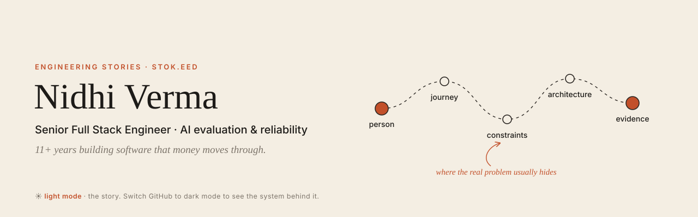
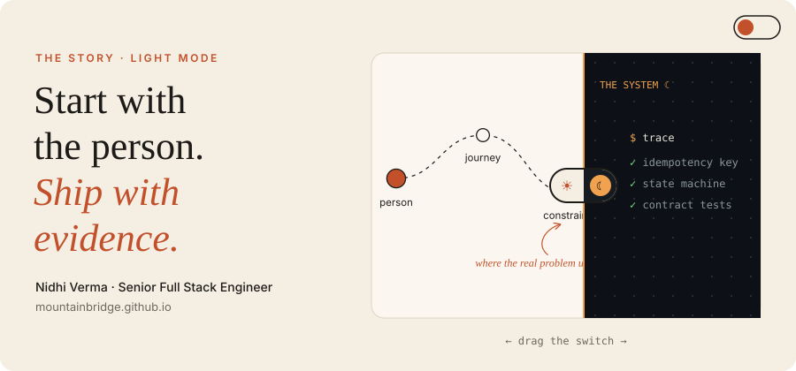
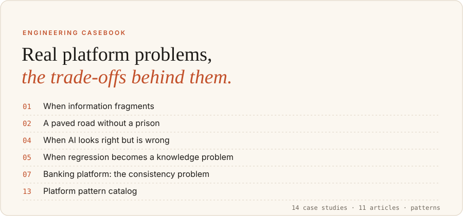

<picture>
  <source media="(prefers-color-scheme: dark)" srcset="./assets/hero-dark.svg">
  
</picture>

<p align="center">
  <a href="https://mountainbridge.github.io"><b>🌐 Visit my portfolio site → mountainbridge.github.io</b></a>
</p>

<p align="center">
  <a href="#-what-i-do">What I do</a> ·
  <a href="#-featured-work">Featured work</a> ·
  <a href="#-how-i-work">How I work</a> ·
  <a href="#-engineering-stories">Engineering Stories</a> ·
  <a href="#-say-hello">Say hello</a>
</p>

<sub><i>Tip: this page has two sides. Flip GitHub between light and dark mode (Settings → Appearance) and the header changes from the story to the system behind it.</i></sub>

---

### ◐ What I do

I'm a Senior Full Stack Engineer with 11+ years building financial software in banking tech. I start with the person who is stuck, follow their journey, name the constraints, and only then pick the architecture. Then I prove it works.

| 🧭 Story first | 🧪 Evidence always | 🤝 Built to be understood |
|---|---|---|
| Map the user journey and hand-offs before writing code | Regression that explains *why* a test failed, not just *that* it failed | Docs, patterns and examples other engineers can pick up and run |
| Workflow and state-machine design for regulated flows | Field-by-field AI output evaluation, weighted by business impact | Internal talks, write-ups and short reels that make complex systems simple |

**Stack:** TypeScript · React · Node.js · Java · Spring · REST · micro-frontends · LLM evaluation · agents · MCP

---

### ◐ Featured work

#### 1 · [Agent from Zero](https://github.com/MountainBridge/agent-from-zero)
Build an AI agent in six runnable parts: model → tool → loop → MCP → skills → SDK. The code behind my @stok.eed series. **18 tests, CI green, runs with no API key.** [▶ Run it in your browser](https://stackblitz.com/github/MountainBridge/agent-from-zero?startScript=demo)

<a href="https://github.com/MountainBridge/agent-from-zero"></a>

#### 2 · [Portfolio site](https://mountainbridge.github.io)
Hand-built, no framework. Drag the sun/moon switch to slide between the story (light) and the system behind it (dark). Keyboard, touch and reduced-motion friendly.

<a href="https://mountainbridge.github.io"></a>

#### 3 · [Engineering Casebook](https://github.com/MountainBridge/MountainBridges)
Real platform problems and the trade-offs behind them: payments consistency, AI output that looks right but is wrong, regression as a knowledge problem.

<a href="https://github.com/MountainBridge/MountainBridges"></a>

**Also:** [Basic-MFE](https://github.com/MountainBridge/Basic-MFE) (micro-frontends with Module Federation) · [DSA](https://github.com/MountainBridge/DSA) (problem-solving notes)

---

### ◐ How I work

```text
person  →  journey  →  constraints  →  architecture  →  evidence
 who is      where it     what can't      the simplest     tests, evals
 stuck?      breaks       change          design that fits and proof
```

---

### ◐ Engineering Stories

On **[@stok.eed](https://www.instagram.com/stok.eed)** I explain how AI and production software really work, the way I'd answer in a senior interview:

- **AI agents from zero:** model, tool, loop, MCP, skills, with [the code for every episode](https://github.com/MountainBridge/agent-from-zero) ([a loop is the difference](https://www.instagram.com/stok.eed/reel/DeoNS_GzWXA/) · [who really opens your files](https://www.instagram.com/stok.eed/reel/DehUVBqz27t/))
- **AI system design for real problems:** [stopping voice-clone scam calls](https://www.instagram.com/stok.eed/reel/DfM-IRbzoz1/)
- **Demo vs production:** [what breaks at 2 a.m.](https://www.instagram.com/stok.eed/reel/DekNB_0Tndd/)

---

### ◐ Say hello

Open to Senior / Staff Full Stack, Developer Experience and AI-reliability roles.

[Portfolio](https://mountainbridge.github.io) · [LinkedIn](https://www.linkedin.com/in/nidhiverma200) · [Instagram @stok.eed](https://www.instagram.com/stok.eed) · [Casebook](https://github.com/MountainBridge/MountainBridges)
